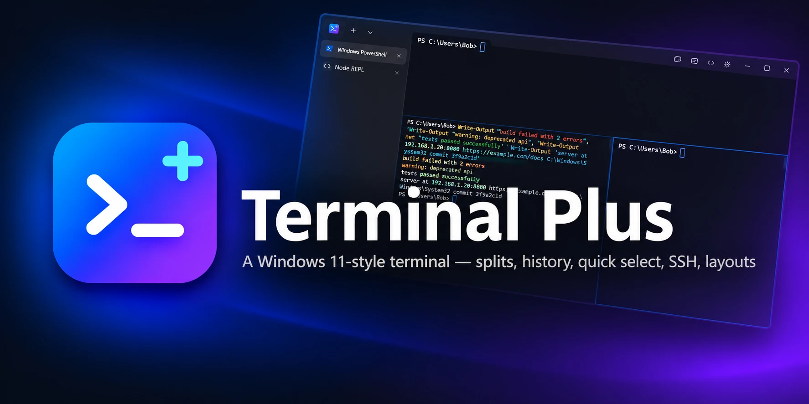
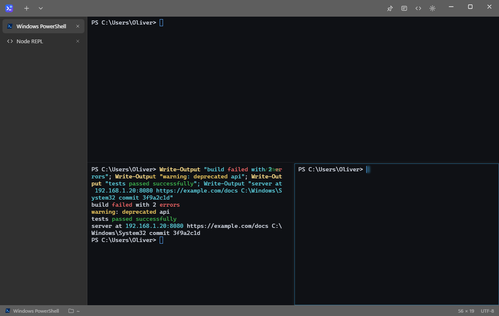

<div align="center">



# Terminal Plus

**A Windows 11-style terminal: tabs, resizable split panes, shell integration, command history, quick select, SSH manager, saved layouts and session restore.**

[](https://github.com/bj4978693-sketch/terminal-plus)
[](https://github.com/bj4978693-sketch/terminal-plus/stargazers)
[](https://github.com/bj4978693-sketch/terminal-plus/network/members)
[](https://github.com/bj4978693-sketch/terminal-plus/releases/latest)
[](https://github.com/bj4978693-sketch/terminal-plus/releases)
[](https://github.com/bj4978693-sketch/terminal-plus/actions/workflows/build.yml)
[](https://github.com/bj4978693-sketch/terminal-plus/issues)


[](LICENSE)

[**⬇ Download**](https://github.com/bj4978693-sketch/terminal-plus/releases/latest) · [Features](#features) · [Build](#build-from-source) · [Report a bug](https://github.com/bj4978693-sketch/terminal-plus/issues/new?template=bug_report.yml) · [Request a feature](https://github.com/bj4978693-sketch/terminal-plus/issues/new?template=feature_request.yml)



</div>

## Why Terminal Plus?

Windows Terminal is great, but many of its most-upvoted requests on GitHub are still open. Terminal Plus was built from that list, plus requests from WezTerm, Tabby, Ghostty, Kitty and Warp users.

| You want… | Windows Terminal | Terminal Plus |
|---|---|---|
| Resize split panes by dragging with the mouse | Requested ([#992](https://github.com/microsoft/terminal/issues/992)) | ✅ Drag the divider, double-click to reset |
| Drag a tab onto a pane to make a split | Requested ([#4587](https://github.com/microsoft/terminal/issues/4587)) | ✅ |
| A notification when a long command finishes | Requested ([#6372](https://github.com/microsoft/terminal/issues/6372)) | ✅ With exit code and run time |
| See when each command ran | Requested ([#9331](https://github.com/microsoft/terminal/issues/9331)) | ✅ Time, ✓ / ✗ exit code and duration on every command |
| A status bar | Requested ([#3459](https://github.com/microsoft/terminal/issues/3459)) | ✅ Shell, folder (click to open), git branch, last result |
| Highlight errors and warnings in output | Requested ([#6297](https://github.com/microsoft/terminal/issues/6297)) | ✅ Built-in rules plus your own regex |
| Tabs down the side | Requested ([#835](https://github.com/microsoft/terminal/issues/835)) | ✅ Vertical tabs |
| Activity alert for background tabs | Requested ([#7955](https://github.com/microsoft/terminal/issues/7955)) | ✅ Dot on the tab, pulsing icon while running |
| Record a session | Requested ([#469](https://github.com/microsoft/terminal/issues/469)) | ✅ Save as asciinema `.cast` |
| Quake mode that remembers its size | Requested ([#12594](https://github.com/microsoft/terminal/issues/12594)) | ✅ Drop-down height setting, hides on click-away |
| Choose the pane highlight color | Requested ([#3061](https://github.com/microsoft/terminal/issues/3061)) | ✅ Accent color setting |
| Ask before closing a pane that is still running something | Requested ([#6549](https://github.com/microsoft/terminal/issues/6549)) | ✅ |

**Also only in Terminal Plus:**
- **Quick select:** a letter appears on every URL, path, IP address, hash and number on screen. Type it to copy, with no mouse.
- **Searchable history across all sessions and shells**, with exit codes, folders and times. Delete single entries.
- **Snippets with fill-in blanks**, e.g. `netstat -ano | findstr :{{port}}` asks for the port.
- **Saved layouts:** reopen a whole project's tabs, splits and folders in one click.
- **SSH manager** with hosts from `~/.ssh/config` added automatically.
- **Copy the last command's output** or **re-run the last command** with one shortcut.
- **Paste guard** that shows what you're about to paste before multi-line text runs.
- Every shortcut can be remapped in a click-and-press editor, with clashes shown in red.

**Honest trade-offs:** Terminal Plus is built on Electron, so the exe is bigger (about 112 MB) and uses more memory than Windows Terminal. It is not code-signed yet, so SmartScreen warns on first run. It can't show images inside the terminal, scroll horizontally, or use font ligatures, because of Windows ConPTY and xterm.js limits.

## Download

Get `TerminalPlus.exe` from the [Releases](../../releases) page. It is portable: no install, just run it.
Windows SmartScreen may warn the first time because the exe is not code-signed: click **More info → Run anyway**.

Open in a folder: `TerminalPlus.exe C:\Projects`. Open a specific shell: `TerminalPlus.exe --profile gitbash`.

## Build from source

Needs Node.js 20+ on Windows.

```
npm install
npm start          # run
npm run dist       # build dist/TerminalPlus.exe
```

Build from a short folder path (e.g. `C:\src\terminal-plus`): the installer tool fails on paths longer than 260 characters.

Every push builds the exe on GitHub Actions. Pushing a tag such as `v1.0.0` creates a Release with the exe attached.

## Features

**Shell integration** (PowerShell, cmd, Git Bash — on by default)
- Every command gets a ✓ / ✗ exit-code badge with its run time, plus a marker in the scrollbar
- Jump between commands: `Ctrl+Shift+↑ / ↓`
- Copy the last command's output: `Ctrl+Shift+O`
- Folder tracking: tab titles, status-bar path (click to open in Explorer), git branch
- New tabs and splits open in the current folder
- Windows notification when a long command finishes while you are elsewhere
- Taskbar-style progress bar on the tab (OSC 9;4, used by winget and others)

**History and snippets**
- Every command saved and searchable across sessions: `Ctrl+Shift+H` or the History panel
- Snippets with fill-in values: `netstat -ano | findstr :{{port}}` asks for `port` each time

**Tabs and panes**
- Split right / down / auto (`Alt+Shift+=`, `Alt+Shift+-`, `Alt+Shift+D`), drag dividers to resize, double-click to reset
- Zoom a pane (`Ctrl+Shift+Z`), read-only lock (`Ctrl+Shift+L`), type in all panes (`Ctrl+Shift+B`)
- Tab colors, rename, duplicate (`Ctrl+Shift+D`), close others / to the right, drag to reorder
- Restore tabs, splits, folders and output on next launch

**Safety and input**
- Warning before pasting multiple lines
- Drag files or folders in to paste their quoted path
- Ctrl+click a Windows path to show it in Explorer (never runs it)
- OSC 8 hyperlinks, OSC 52 clipboard writes (reads blocked)

**SSH**: save hosts (user@host, port, key file); hosts in `~/.ssh/config` appear automatically. Uses Windows OpenSSH.

**Look**: 11 color schemes, import any Windows Terminal scheme (JSON), background opacity over Mica, font / weight / line height / letter spacing / cursor shape, GPU (WebGL) rendering.

**Windows**: show/hide hotkey from any app (`` Alt+` ``), always on top, full screen (F11), start at sign-in, "Open in Terminal Plus" on folder right-click.

**v3 — from the most-upvoted requests on GitHub (Windows Terminal, WezTerm, Tabby, Ghostty, Kitty, Warp, Alacritty)**
- Remap any shortcut: Settings → Keyboard (click, press keys; clashes shown in red)
- Vertical tabs on the left; drag a tab onto a pane to join it as a split; move a pane to its own tab; swap and equalize panes
- Saved layouts: name a set of tabs, splits and folders, reopen in one click
- Quick select (`Ctrl+Shift+Space`): letters appear on every URL, path, IP, hash and number on screen; type them to copy (Shift = insert)
- History suggestions at the prompt (`Ctrl+Alt+Space`); forget single history entries
- Keyword highlighting: error / warning / success / IP colored by default, your own regex rules
- Record a pane to an asciinema `.cast` file (`Ctrl+Shift+R`)
- Re-run last command (`Ctrl+Shift+Enter`), command start times on badges
- Follow Windows light/dark automatically, custom accent color, animated cursor trail, smooth scrolling
- Ctrl+wheel zooms one pane, Alt+click moves the prompt cursor, middle-click paste, smart double-click selects whole paths
- Warns before closing a pane with a running command; MRU Ctrl+Tab option
- Custom profiles (any program, e.g. `python`, `node`); desktop shortcut per profile; `--profile <id>` on the command line
- Drop-down Quake mode from the top of the screen, hide on click-away; tray icon, close to tray, start hidden at sign-in
- Administrator window (UAC prompt, red title bar line)
- Export / import settings

Not done (ConPTY or xterm.js limits): inline images, horizontal scrolling, font ligatures, tmux control mode.

Press **F1** for every shortcut, **Ctrl+Shift+P** for every command.

## Files

- `main.js` — window, shells (node-pty / ConPTY), shell-integration scripts, settings, session, history, Windows integration
- `preload.js` — safe IPC bridge
- `src/renderer.js` — UI logic; `src/icons.js` — custom icon set; `src/themes.js` — schemes + importer; `src/style.css`
- `gen-icon.js` — draws `assets/icon.png`

Data lives in `%APPDATA%\terminal-plus` (`settings.json`, `history.json`, `session.json`).

Self-check: `TP_SHOT=out.png [TP_SHOT_JS=code] [TP_LOG=log.txt] npm start` launches, runs code, saves a screenshot and quits.

## License

MIT — see [LICENSE](LICENSE).
